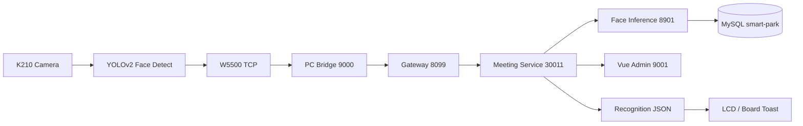

# 🏙️ Intelligent Mansion — Pixel Face Check-In

<div align="center">
  
  <br/><br/>
  
  
  
</div>

> **当前状态：人脸采集、识别、签到、回显闭环已跑通。**  
> 首期面向单会议室、单终端的本地部署；后续向多人、多终端和园区平台扩展。

---

## 🕹️ 系统快照

| 模块 | 技术栈 | 现状 |
| --- | --- | --- |
| 🧠 **现场终端** | XiUOS / XiZi + K210 KPU + OV 摄像头 | YOLOv2 连续帧检测，`320×240 RGB565` 上传 |
| 🌐 **通信链路** | W5500 硬件 TCP + 自定义 `XPH1` 协议 | CRC32 校验、ACK 确认、识别结果 JSON 回传 |
| 🖥️ **PC 桥接** | Python + Pillow | 接收图像、方向校正、JPEG 转换、调用后端 |
| 👤 **人脸识别** | YuNet + SFace | 单人脸特征提取、余弦相似度、`0.50` 阈值 |
| 🗄️ **考勤业务** | Spring Cloud + MyBatis-Plus + MySQL | 人员审核、会议名单、幂等、签到状态机 |
| 🎛️ **管理前端** | Vue + Ant Design Vue | 人员、会议、详情页、上传与签到记录 |



## 🚀 快速启动

### 1️⃣ 启动容器化后端

```powershell
cd code/docker
docker compose up --build -d
docker compose ps
```

### 2️⃣ 启动本机设备控制

```powershell
cd code
.\Start-Device-Control.cmd
```

这会启动 `9010` 控制服务、监听板端串口日志，并在会议详情页按需启动 `9000` 桥接。

### 3️⃣ 打开管理端

```text
http://localhost:9001
```

默认管理流程：

1. 登录后进入 **人脸识别签到**。
2. 新增人员并上传现场人脸照片。
3. 在人员列表中点击 **通过**，只有审核通过人员才会参与识别。
4. 创建会议、选择与会人员。
5. 打开会议详情页，点击 **启动本会议识别**。

## 🔌 关键端口

| 服务 | 端口 | 用途 |
| --- | ---: | --- |
| `face-frontend` | `9001` | 管理页面 |
| `park-gateway` | `8099` | 统一 API 网关 |
| `park-system` | `30010` | 登录、用户、权限 |
| `park-meeting` | `30011` | 会议与签到业务 |
| `face-inference` | `8901` | 人脸检测与特征比对 |
| `device_control.py` | `9010` | 本机设备控制 |
| `api_bridge.py` | `9000` | 板端图像桥接 |
| MySQL | `3307 → 3306` | 业务数据库 |
| Redis | `6380 → 6379` | 缓存 |
| Nacos | `8850 → 8848` | 注册中心 |

## ✨ 已实现闭环

- ✅ 稳定人脸触发：连续 5 帧有人脸后上传第 5 帧。
- ✅ 图像上传：CRC32 校验、PC ACK、图片保存与结果回传。
- ✅ 识别比对：YuNet 检测 + SFace 特征 + 余弦相似度。
- ✅ 业务幂等：请求、与会人员重复签到、非成功事件去重。
- ✅ 审核控制：只有启用且审核通过的人员参与识别。
- ✅ 管理页面：人员管理、会议管理、详情页、记录与导出。
- ✅ 板端反馈：识别结果 JSON 回传，PC 可按会议启停桥接。

## 🧪 识别规则

| 分类 | 值 | 业务含义 |
| --- | ---: | --- |
| 与会人员 | `1` | 命中且属于当前会议 |
| 非与会人员 | `2` | 命中但不在当前会议名单 |
| 非记录人员 | `3` | 未命中已审核人员 |

签到状态包括成功、重复签到、无权限、未识别、时间窗外、迟到与处理失败。当前相似度阈值为 `0.50`，模型为 `SFace 2021dec`。

## 📦 主要入口

| 路径 | 说明 |
| --- | --- |
| [`pc_bridge/api_bridge.py`](pc_bridge/api_bridge.py) | 正式识别桥接 |
| [`pc_bridge/device_control.py`](pc_bridge/device_control.py) | 设备控制服务 |
| [`face_match/service.py`](face_match/service.py) | 推理 HTTP 服务 |
| [`smart-park-backend/`](smart-park-backend/) | Spring Cloud 后端 |
| [`face-checkin/`](face-checkin/) | Vue 管理端 |
| [`docker/docker-compose.yml`](docker/docker-compose.yml) | 本地编排 |
| [`XiUOS/`](XiUOS/) | K210/XiUOS 板端代码 |

## 🛠️ 当前边界

- 🔒 `/verify` 目前在网关白名单中，设备 token 适合联调，生产需要设备签名或独立凭据。
- 🖼️ 人员照片仍以 base64 存库，后续应迁移到对象存储或受控文件服务。
- 🧮 识别为逐人比对，后续应只提取一次现场特征并批量比对。
- 🧾 CSV 导出仍需补齐公式注入防护。
- 📡 前端目前轮询刷新，后续可升级 SSE/WebSocket。

## 🧭 分支说明

当前 README 属于 `front2back` 分支，主要聚焦**端到端人脸识别签到链路**，不包含完整智慧园区所有业务能力的交付承诺。

<div align="center">
  <sub>
    <b>PIXEL HUD · LOCAL-FIRST · FACE CHECK-IN</b>
    <br/>
    <code>K210</code> · <code>W5500</code> · <code>XiUOS</code> · <code>SFace</code> · <code>Spring Cloud</code> · <code>Vue</code>
  </sub>
</div>
