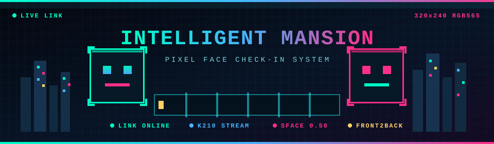
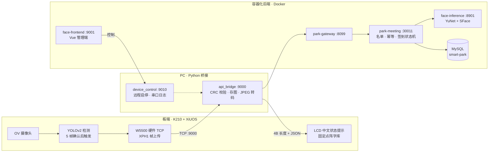

<div align="center">

<a href="#系统快照">

</a>

<br/>

[](#已实现闭环)
[](#固件编译与测试)
[](#系统快照)
[](#分支说明)

<br/>

```text
> 采集 → 上传 → 识别 → 签到 → 回显 · 端到端闭环已在板端实测跑通
> 首期：单会议室 · 单终端 · 本地部署    后续：多人 · 多终端 · 园区平台
```

**目录** · [系统快照](#系统快照) · [端到端链路](#端到端链路) · [快速启动](#快速启动) · [关键端口](#关键端口) · [已实现闭环](#已实现闭环) · [板端结果显示](#板端考勤结果显示) · [固件](#固件编译与测试) · [识别规则](#识别规则) · [主要入口](#主要入口) · [文档导航](#文档导航) · [当前边界](#当前边界) · [分支说明](#分支说明)

</div>

---

## 系统快照

| 模块 | 技术栈 | 现状 |
| --- | --- | --- |
| **现场终端** | XiUOS / XiZi + K210 KPU + OV 摄像头 | YOLOv2 连续帧检测，`320×240 RGB565` 上传 |
| **通信链路** | W5500 硬件 TCP + 自定义 `XPH1` 协议 | CRC32 校验、ACK 确认、识别结果 JSON 回传 |
| **PC 桥接** | Python + Pillow | 接收图像、方向校正、JPEG 转换、调用后端 |
| **人脸识别** | YuNet + SFace | 单人脸特征提取、余弦相似度、`0.50` 阈值 |
| **考勤业务** | Spring Cloud + MyBatis-Plus + MySQL | 人员审核、会议名单、幂等、签到状态机 |
| **管理前端** | Vue + Ant Design Vue | 人员、会议、详情页、上传与签到记录 |

## 端到端链路



同一张人脸从按下快门到 LCD 亮出结果，大约两秒：图像帧经 W5500 直达 PC，
`/verify` 串起网关、业务、推理三层，识别结果沿**原 TCP 连接**回到板端。

### XPH1 协议速查

上行图像帧（24 字节头，大端）：

```text
偏移  0        4            8          10          12            16            20     24
      +--------+------------+----------+-----------+-------------+-------------+------+
      | "XPH1" |     id     |  width   |  height   |    size     |    crc32    | fmt  |
      +--------+------------+----------+-----------+-------------+-------------+------+
         4 B        4 B           2 B        2 B          4 B           4 B       4 B
```

`fmt = 1` 表示 RGB565 裸帧；`crc32` 覆盖全部像素数据，头尾任一校验不符即拒收。

下行结果（`XPA1` ACK 之后，同一 TCP 连接）：

```text
      +--------------+-----------------------------------+
      |  JSON 长度    |        JSON（UTF-8）              |
      +--------------+-----------------------------------+
          4 B 大端                ≤ 2048 B
```

PC 发完即 `shutdown(SHUT_WR)` 半关闭；板端读完 JSON 解析
`status / message / boardText` 后关闭连接，PC 将此 EOF 记为送达确认。
完整字节表、超时参数与抓包对照见
[docs/11 §6 协议速查](docs/11_人脸采集链路交接文档.md)。

## 快速启动

### 1. 启动容器化后端

```powershell
cd code/docker
docker compose up --build -d
docker compose ps
```

### 2. 启动本机设备控制

```powershell
cd code
.\Start-Device-Control.cmd
```

> 启动 `9010` 控制服务、监听板端串口日志，并在会议详情页按需启动 `9000` 桥接。

### 3. 打开管理端

浏览器访问 `http://localhost:9001`，默认管理流程：

1. 登录后进入 **人脸识别签到**
2. 新增人员并上传现场人脸照片
3. 人员列表中点击 **通过**，只有审核通过人员才会参与识别
4. 创建会议、选择与会人员
5. 会议详情页点击 **启动本会议识别**

## 关键端口

**容器化服务**

| 服务 | 端口 | 用途 |
| --- | :---: | --- |
| `face-frontend` | `9001` | 管理页面 |
| `park-gateway` | `8099` | 统一 API 网关 |
| `park-system` | `30010` | 登录、用户、权限 |
| `park-meeting` | `30011` | 会议与签到业务 |
| `face-inference` | `8901` | 人脸检测与特征比对 |

**本机桥接脚本**

| 脚本 | 端口 | 用途 |
| --- | :---: | --- |
| `api_bridge.py` | `9000` | 板端图像桥接（签到主链） |
| `device_control.py` | `9010` | 设备控制 + 板端串口日志 |

**基础设施**

| 组件 | 端口 | 用途 |
| --- | :---: | --- |
| MySQL | `3307 → 3306` | 业务数据库 |
| Redis | `6380 → 6379` | 缓存 |
| Nacos | `8850 → 8848`、`9850 → 9848` | 注册中心（HTTP / gRPC） |

## 已实现闭环

- ✅ 稳定人脸触发：连续 5 帧有人脸后上传第 5 帧
- ✅ 图像上传：CRC32 校验、PC ACK、图片保存与结果回传
- ✅ 识别比对：YuNet 检测 + SFace 特征 + 余弦相似度
- ✅ 业务幂等：请求、与会人员重复签到、非成功事件去重
- ✅ 审核控制：只有启用且审核通过的人员参与识别
- ✅ 管理页面：人员管理、会议管理、详情页、记录与导出
- ✅ 板端反馈：W5500 同连接接收识别结果 JSON，并在 LCD 显示固定中文考勤结果
- ✅ 板端实测：真机采集、上传、识别、回传、LCD 显示全链路走通（`v27` 固件）

## 板端考勤结果显示

板端上传 RGB565 图片并收到 `XPA1` 图片保存 ACK 后，**不会立即关闭 TCP
连接**；它会继续读取 PC 桥接返回的识别结果。该能力仅适用于当前的
**W5500 有线 TCP** 链路，Wi-Fi（ESP8285 AT）链路不包含此回传消费逻辑。

```text
K210 图片上传 → PC 保存图片并回 XPA1 ACK
              → PC 调用 /verify，写入考勤结果
              → PC 回传 4B JSON 长度（网络序）+ UTF-8 JSON
              → XiUOS 校验、解析 status/message → LCD 提示
```

报文最大为 `2048` 字节，读取超时为 `3` 秒。图片 ACK 成功后，即使 JSON
超时、截断或格式不正确，板端也只降级显示"人像已完成采集"，**绝不重新上传
同一张图片**，从而避免重复签到。

| `status` | LCD 文案 | 文字颜色 |
| :---: | --- | :---: |
| `1` | 签到成功 | 绿 `#07E0` |
| `2` | 已签到 | 黄 `#FFE0` |
| `3` | 无权限 | 红 `#F800` |
| `4` | 未识别 | 白 `#FFFF` |
| `5` | 签到未开始 / 签到已结束 | 白 `#FFFF` |
| `7` | 暂不可用 | 白 `#FFFF` |
| 其他或结果报文失败 | 识别失败 / 人像已完成采集 | 白 `#FFFF` |

LCD 使用预生成的固定中文点阵字库
[`photo_toast_font.h`](XiUOS/App_Framework/Framework/knowing/kpu/k210_yolov2_detect_procedure/photo_toast_font.h)，
因此不需要在编译前手动替换该文件。PC 的 `boardText` 和姓名仍会写入板端
串口日志；为避免 K210 缺少通用中文字库时显示乱码，LCD 只显示上述固定结果文案。

## 固件：编译与测试

### 编译 XiUOS 固件

在已配置 `make`、`riscv-none-embed-gcc` 的 XiUOS Linux/VM 构建环境中执行：

```bash
cd XiUOS/Ubiquitous/XiZi_IIoT
make BOARD=edu-riscv64
```

`make BOARD=edu-riscv64 -j2` 与上述构建内容相同，只是最多并行执行两个任务；
首次编译或排查错误时建议不加 `-j2`，日志更易阅读。

若将源码复制到另一份工作区，或修改固定 LCD 文案，可重新生成点阵头文件：

```powershell
python pc_bridge\generate_toast_font.py
```

> 需要 Pillow 与微软雅黑字体（Windows 自带）；生成的头文件已入库，
> PC 接收器与板端编译均不依赖 Pillow。

`bins/` 目录保留历次烧录镜像，最近一次实机验证使用 `XiZi-edu-riscv64-v27.bin`。

### 主机回归测试

固件头文件可以在主机上用 gcc 直接编译运行，配合 mock 的 W5500 API 做
10 轮故障注入（连接、发送、ACK、JSON 各阶段超时，ID/CRC 篡改，断连等），
再走一次真实 TCP 回环把帧送进 PC 接收器转成 PNG：

```bash
python pc_bridge/test_ethernet_firmware.py     # 板端固件主机回归（需要 PATH 中有 gcc）
python pc_bridge/test_board_result.py          # 结果回传协议
python pc_bridge/test_tcp_bridge.py            # 图像桥接收发
```

两条 `PASS` 输出即全绿：状态机与故障注入一条，真实帧到 PC 接收器回环一条。

## 识别规则

| 分类 | 值 | 业务含义 |
| --- | :---: | --- |
| 与会人员 | `1` | 命中且属于当前会议 |
| 非与会人员 | `2` | 命中但不在当前会议名单 |
| 非记录人员 | `3` | 未命中已审核人员 |

签到状态包括成功、重复签到、无权限、未识别、时间窗外、迟到与处理失败。
当前相似度阈值为 `0.50`，模型为 `SFace 2021dec`。

## 主要入口

| 路径 | 说明 |
| --- | --- |
| [`pc_bridge/api_bridge.py`](pc_bridge/api_bridge.py) | 正式识别桥接 |
| [`pc_bridge/device_control.py`](pc_bridge/device_control.py) | 设备控制服务 |
| [`face_match/service.py`](face_match/service.py) | 推理 HTTP 服务 |
| [`smart-park-backend/`](smart-park-backend/) | Spring Cloud 后端 |
| [`face-checkin/`](face-checkin/) | Vue 管理端 |
| [`docker/docker-compose.yml`](docker/docker-compose.yml) | 本地编排 |
| [`XiUOS/`](XiUOS/) | K210/XiUOS 板端代码 |
| [`XiUOS/.../photo_ethernet.h`](XiUOS/App_Framework/Framework/knowing/kpu/k210_yolov2_detect_procedure/photo_ethernet.h) | W5500 图片上传与识别结果接收 |
| [`XiUOS/.../photo_bridge.h`](XiUOS/App_Framework/Framework/knowing/kpu/k210_yolov2_detect_procedure/photo_bridge.h) | LCD 结果状态映射与渲染 |

## 文档导航

| 文档 | 内容 |
| --- | --- |
| [docs/09 进度与详细设计报告](docs/09_人脸识别签到模块进度与详细设计报告.md) | 协议、幂等、状态机的权威设计 |
| [docs/10 扫描与修复记录](docs/10_人脸识别签到模块扫描与修复记录.md) | 历次问题扫描与修复过程 |
| [docs/11 硬件交接文档](docs/11_人脸采集链路交接文档.md) | 接线清单、启动方式、协议速查、故障排查 |
| docs/01-07 | 需求文档与 XiUOS 实验原始资料 |

## 当前边界

| 主题 | 现状 | 生产化方向 |
| --- | --- | --- |
| 鉴权 | `/verify` 在网关白名单中，设备 token 适合联调 | 设备签名或独立凭据 |
| 照片存储 | 人员照片以 base64 直接入库 | 迁移对象存储或受控文件服务 |
| 比对性能 | 逐人比对 | 现场特征一次提取，批量比对 |
| 导出安全 | CSV 导出未防公式注入 | 输出转义与危险前缀防护 |
| 前端实时性 | 轮询刷新 | SSE / WebSocket 推送 |

## 分支说明

- **`main`**：标准版本。端到端链路已在板端实测跑通（`v27` 固件）。
- **`front2back`**：活跃开发分支。本 README 与最新文档先行落地于此，稳定后合回 `main`。

板端显示当前存在两套实现待合并决策：`main` 采用
`photo_toast_font.h` 固定 `168×28` 九张点阵图方案；`front2back` 采用
`photo_status_font.h` 变宽位图加单字节回执方案。两者共用同一
`XPH1/XPA1` 协议，联调互不影响。

---

<div align="center">

```text
INTELLIGENT MANSION · PIXEL FACE CHECK-IN · END-TO-END VERIFIED
```

<sub><b>K210</b> · <b>W5500</b> · <b>XiUOS</b> · <b>SFace</b> · <b>Spring Cloud</b> · <b>Vue</b></sub>

</div>
