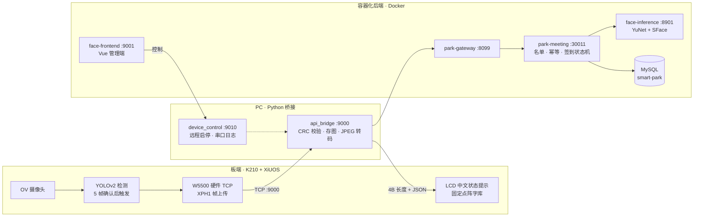

<div align="center">

<a href="#项目总览">

</a>

<br/>

[](#已实现闭环)
[](#固件编译与测试)
[](#系统快照)
[](#分支说明)

<br/>

```text
> 采集 → 上传 → 识别 → 签到 → 回显 · 端到端闭环已在板端实测跑通
> 首期：单会议室 · 单终端 · 本地部署    后续：多人 · 多终端 · 园区平台
```

**目录** · [项目总览](#项目总览) · [工作总结](#工作总结) · [系统快照](#系统快照) · [端到端链路](#端到端链路) · [快速启动](#快速启动) · [关键端口](#关键端口) · [已实现闭环](#已实现闭环) · [板端结果显示](#板端考勤结果显示) · [固件](#固件编译与测试) · [识别规则](#识别规则) · [主要入口](#主要入口) · [文档导航](#文档导航) · [当前边界](#当前边界) · [分支说明](#分支说明)

</div>

---

## 项目总览

**智慧楼宇人脸识别签到系统**——一套从摄像头到 LED 屏全链路自研的会议签到方案：

K210 板端（XiUOS 实时操作系统）用 YOLOv2 连续帧检测人脸，触发后经 W5500 硬件 TCP
将 320×240 RGB565 原始帧通过**自研 XPH1 二进制协议**上传 PC；Python 桥接完成 CRC
校验、JPEG 转码后调用容器化 Spring Cloud 后端，由 YuNet + SFace 完成特征比对，
`park-meeting` 按"人员审核 → 会议名单 → 幂等去重 → 签到状态机"落库；识别结果沿
**同一条 TCP 连接**回传板端，LCD 以预烘焙点阵位图直接显示"签到成功 / 已签到 /
非与会人员 / 未识别"等中文状态。从人到镜头前到结果可用约 **3~5 秒**；其中
采集→上传→识别→签到闭环已在真机实测跑通，识别结果回传链路已完成双侧实现与
主机场景测试（待板端联调）。

| 关键数字 | 数值 |
| --- | --- |
| 端到端时延（人到镜头前 → 结果可用） | 约 3~5 s（含 5 帧确认，实测日志统计） |
| 人脸识别 | YuNet `2023mar` 检测 + SFace `2021dec` 比对，余弦阈值 `0.50` |
| 后端接口级回归 | 30 PASS / 1 EXPECTED FAIL（预期失败项：无照片保存） |
| Python 主机回归 | 29 用例（27 绿，2 个为存量环境问题） |
| 固件主机场景测试 | gcc 编译真实固件头文件 + 10 轮故障注入全绿 |
| 问题扫描与修复 | 三轮全量扫描（H/M/L/R/N/T 系列），识别问题 30+ 项：可修项全部修复，其余确认为环境边界或产品决策 |
| 前端首屏体积优化 | 5.0 MB → 3.2 MB（−39%） |
| 技术栈层次 | 板端固件 / 通信协议 / PC 桥接 / 推理服务 / 微服务后端 / 管理前端 |

## 工作总结

### 系统架构与数据流

六个层次，一次识别的完整旅程：

```text
[板端]  OV 摄像头 → YOLOv2 检测（连续 5 帧确认防误触发）
        → W5500 硬件 TCP，XPH1 帧（24B 头 + 153600B RGB565 + CRC32）
[桥接]  api_bridge :9000 校验 CRC → 回 XPA1 ACK → 存图 → JPEG 转码 → base64
[后端]  网关 :8099 → park-meeting :30011 /verify（幂等 → 比对 → 名单 → 状态机）
[推理]  face-inference :8901 YuNet 检测 → SFace 128 维特征 → 余弦相似度
[落库]  MySQL smart-park：上传请求 / 签到事件 / 名单快照
[回传]  同一 TCP 连接：4B 长度前缀 + JSON → 板端解析 status → LCD 显示
        ↓ 全程状态可在管理端观测
[前端]  face-frontend :9001 会议详情页 10s 轮询签到名单 / 上传记录 / 双端日志
```

完整 mermaid 架构图见 [端到端链路](#端到端链路)；协议字节级定义见
[XPH1 协议速查](#xph1-协议速查)与 [docs/11 §6](docs/11_人脸采集链路交接文档.md)。

### 各层实现要点

**板端固件（K210 / XiUOS / XiZi_IIoT）**

- YOLOv2 连续帧检测：5 帧有人脸才触发上传，10 帧无脸重新武装，避免单帧误触发
- 上传不阻塞检测主循环：图片线程独立，上传完成后 `photo_state=4` 等待显示
- 识别结果二阶段消费：ACK 后不关连接，按 4B 大端长度前缀读 JSON（3s 超时）
- JSON 解析用手写 ~30 行极简扫描器（只提取首个整数字段 `status`），不为一个字段引入 cJSON 构建依赖
- LCD 按 `status` 选预烘焙状态位图（6 种短语，`generate_status_fonts.py` 生成）；解析失败降级显示"人像已完成采集"，**绝不重新上传同一张图**（防重复签到）
- 回执策略：仅 JSON 完整消费后回 1 字节，PC 心跳 `board_ack` 只统计"板端真的看懂了结果"

**XPH1 通信协议（自研二进制协议）**

- 上行 24B 头（`"XPH1"` + id + 宽高 + size + crc32 + fmt，大端）+ RGB565 裸帧，`crc32` 覆盖全部像素
- 下行 `XPA1` ACK（12B）之后同一连接发 `4B 长度 + JSON ≤ 2048B`
- PC 发完 JSON 即 `shutdown(SHUT_WR)` 半关闭；W5500 处于 `CLOSE_WAIT` 时 RX 未读数据仍可读（实测驱动语义），板端在 FIN 后照常读完 JSON
- 板端 EOF 表现是**负错误码**而非 0：必须"先判断收齐、再处理错误码"，短读一律降级
- WiFi（ESP8285 AT）链路为独立实现，不含 JSON 回传通路，两链路互不影响

**PC 桥接（Python）**

- `api_bridge.py`：CRC 校验 → ACK → 存图 → 转码 → 调 `/verify` → 解析结果 → 回传板端 → `delivered=yes/no` + `mode=eof/ack` 记账
- `device_control.py`：9010 控制服务，管理桥接进程启停、会议绑定、串口日志采集；子进程日志与自写日志**分文件**存放，避免句柄覆盖
- 串口空读自愈：连续 20 次空读（约 4s）自动重连 USB 串口，状态 `reconnecting → connected`
- `request_id = {桥接启动时间戳}-{板端照片序号}`，板端重启后 ID 归零也不冲突

**人脸推理服务（face_match）**

- 三个模型端点：`/extract`（登记）、`/match-feature`（单比对）、`/match-batch`（现场特征一次提取 vs 全员批量比对）
- `ThreadingHTTPServer` 并发收发 + 全局推理锁串行化模型调用（YuNet/SFace 实例非线程安全）
- 临时文件"解码→比对→立即删除"，`try/finally` 收敛到单模板作用域，异常路径零残留

**考勤后端（Spring Cloud / park-meeting）**

- `/verify` 14 步流程：token 校验 → 请求幂等 → 记录上传 → 比对 → 会议成员检查 → 状态机落库
- 四路幂等去重：请求级（deviceId+requestId+meetingId）、与会人员级（同人同会只一条成功）、非与会人员级（同状态不重插）、非记录人员级（同照片不重记）
- 会议时间双窗口：会议持续时间管识别窗口，考勤截止时间管迟到判断；考勤时间越界自动回退会议窗口
- 人员生命周期：照片必填 → 单人脸校验 → SFace 特征入库 → 待审核；仅 `启用+审核通过` 参与识别；编辑空照片时保留旧照片旧特征
- 复用开场会议快照：verify 内对同一会议的多次重复查询合并为一次快照读取，响应字段不因中途删会议而漂移

**管理前端（Vue + Ant Design Vue）**

- 五页矩阵：签到记录 / 上传记录 / 人员管理 / 会议管理 / 会议详情（详情页承担单会议全部管理）
- 10s 轮询签到名单与上传记录，`hiddenLoading` 去全屏遮罩，页面自身表格 loading 兜底
- CSV 完整名单导出：UTF-8 BOM 防乱码、`=+-@` 前缀防公式注入、≥15 位纯数字加 `'` 防 Excel 精度丢失
- 前端直控 PC：详情页经 nginx 代理调 9010 启停识别桥接、实时查看桥接与板端日志

### 关键技术决策

| # | 决策 | 选择 | 理由 |
| - | --- | --- | --- |
| 1 | 板端上行协议 | 自研 XPH1 二进制协议，弃用 HTTP | K210 跑完整 HTTP/TLS 栈代价过高；W5500 硬件 TCP + 固定 24B 头最省 RAM，协议可字节级验证 |
| 2 | 帧完整性 | CRC32 覆盖全部像素 + ACK 确认 | 有线链路也有抖动，帧级校验让"图坏了"在桥接侧就拦住，不进识别流程 |
| 3 | 结果回传 | 复用原 TCP 连接 + 半关闭定界 | 免去板端二次连接；`shutdown(SHUT_WR)` 是"PC 发完了"的信号，W5500 CLOSE_WAIT 下 RX 仍可读（实测驱动源码确认） |
| 4 | 下行定界 | 4B 大端长度前缀 | 不依赖 EOF/换行，板端按长度精确读取，3s 超时兜底 |
| 5 | 板端解析 | 手写极简扫描器，不用 cJSON | `status` 是受控单行 JSON 的首个整数字段；为一个字段引入构建依赖不值 |
| 6 | LCD 文案 | 预烘焙状态位图，姓名不上板 | 动态 CJK 字库 flash 不可承受；被拍者即本人，姓名在 PC 日志与 web 端可查 |
| 7 | 特征存储 | 比对走 SFace 特征 base64（128 维 float32，684B），不搬原始照片 | 比对只传 684B 特征而非 100KB 照片，推理载荷降两个数量级；`face_vector` 是权威比对依据，`photo_path` 仅作展示兼容 |
| 8 | 识别阈值 | `0.50`（SFace 官方推荐 0.363） | 本地板端样本实测：明显同人多帧相似度 0.70+，最高 0.89；低质量摄像头下 0.363 误识风险偏高，0.50 明显降误识且不过度拒识 |
| 9 | 降级哲学 | JSON 失败只损失文案，不重采图 | 图片已 ACK、签到已落库；重采会造成重复签到请求——宁可少显示，不可多发一次 |
| 10 | 幂等优先 | 先查后插 + 语义去重，DB 唯一键兜底 | 板端会重试、人会对着摄像头反复刷；四路幂等保证任何重放不产生脏数据 |

### 踩坑与解决记录

完整排查过程见 [docs/10](docs/10_人脸识别签到模块扫描与修复记录.md)，精选最有代表性的：

| # | 现象 | 根因 | 修复与验证 |
| - | --- | --- | --- |
| 1 | 6 次刷脸全部"未识别"，且每次都新增一条非记录人员事件 | **双层叠加 bug**：推理服务公共校验要求非 `/extract` 请求必须带 `templateBase64`，把 `/match-batch` 全部拒掉（主根因）；`_load_models` 调用缺必传参数（次生 bug，被前者掩盖——只修一层会立刻炸另一层） | 校验豁免 `/match-batch` + 补 `DET_THRESHOLD` 常量；用库中 6 名真实人员特征直接打接口验证 5/5 命中，相似度 ≈1.0 |
| 2 | Web 端板端日志"连上一会儿就不再滚动" | **三个独立缺陷叠加**：Windows 下 `Popen` 继承句柄丢失 append 语义，子进程心跳从启动时刻的旧偏移**覆写**刚追加的板端日志；串口静默断链不可感知；`/logs` 160 行窗口被心跳挤光 | 桥接日志与控制日志分文件 + 合并读尾部；空读 20 次自动重连；板端行与心跳行分窗口配额。5 用例专项回归全绿 |
| 3 | CSV 导出后长工号尾部变 0 | Excel/WPS 把纯数字按双精度浮点显示，超过 15 位丢精度 | `csvText` 统一转义路径：≥15 位纯数字加 `'` 前缀强制文本；人员 ID/请求 ID 同步获得保护 |
| 4 | 前端"实在太卡" | 四根因叠加：nginx 未开 gzip、antd 全量进首屏（单 chunk 2.0MB）、tinymce 被 `require.context` 全局注册拖进主包、10s 轮询触发全屏 Loading 遮罩闪烁 | 开 gzip、关 sourcemap（js 目录 54MB→11.8MB）、轮询加 `hiddenLoading`、构建切 prod 模式；首屏 5.0MB→3.2MB（−39%） |
| 5 | 前端新包上线即白屏 | 改 `ENV_MODE=dev→prod` 后 `publicPath` 联动变为 `/wisdom-park/`，nginx 无此路径映射，`try_files` 回落把 HTML 当 JS 执行 | nginx 增加 `location /wisdom-park/` alias 映射 + 热更新。**教训：构建环境变量影响的不止编译行为，上线前需模拟浏览器逐资源请求回归** |
| 6 | 逐人推理性能差（N+1） | 每次识别对每个候选人单独调用推理 | 新增 `/match-batch`：现场照片特征只提取一次，批量比对全员特征 |
| 7 | 轮询查询越来越重 | `listAttendance/listRequests` 未加投影，每 10s 把全部记录的 `photo_path`（base64 照片，~37KB/条）拉进 JVM | SQL 层投影排除大字段；实测每轮少拉 ~1MB 无效流量 |
| 8 | 推理容器 `/tmp` 文件缓慢累积 | 模板临时文件清理作用域错误：循环中覆盖赋值，异常路径 `finally` 只清最后一个 | "解码→比对→立即删除"收敛到单模板作用域；构造非法模板走异常路径验证计数归零 |
| 9 | 幂等请求 ID 板端重启后冲突 | 板端 `photo_id` 是静态变量，重启归零 | `request_id` 混入桥接进程启动时间戳，且幂等键加入会议 ID，板端重启互不影响 |

### 质量保障与验证

三层验证体系，全部可在主机复现：

1. **主机单元/场景回归**：Python unittest 29 用例（桥接收发、设备控制、回传协议、日志合并）；固件头文件在主机 gcc 下编译，mock W5500 API 做 10 轮故障注入（连接/发送/ACK/JSON 各阶段超时、ID/CRC 篡改、断连、tick 回绕），再走真实 TCP 回环把帧送进 PC 接收器转 PNG
2. **接口级业务回归**：30 项核心接口与业务规则用例（人员生命周期、会议时间规则、四路幂等、CSV 导出、设备控制），30 PASS / 1 EXPECTED FAIL
3. **运行时实证**：docker logs 的 SQL 形态核验（投影是否生效、N+1 是否消除）、MySQL 通用日志计数、容器 `/tmp` 文件计数、模拟浏览器逐资源请求（白屏回归）

部署验证链：`docker cp` 热修 + 重启即时验证 → 源码同步修复 → `docker compose up --build` 重建固化，镜像内不含历史热修残留。

### 里程碑

| 阶段 | 内容 |
| --- | --- |
| 2026-10-14 ~ 10-20 | 平台对接与首次传输打通：板端接口脚本、双核输出修复、WiFi 传输实验 |
| 2026-10-21 | 链路选型定稿：**弃用 WiFi，改用 W5500 网线传输**（`bin-v25`）；引入 `face_match` 推理模块 |
| 2026-10-22 | 端到端闭环**板端实测跑通**（`v27` 固件）；30 项接口回归通过；docs/09 详细设计报告成稿；首轮全量扫描修复 |
| 2026-10-23 | 实测双问题排查（推理批量校验、串口日志覆写）；加固二轮扫描修复（R 系列）；CSV 防护加固；前端性能优化与白屏事故修复 |
| 2026-10-24 | 识别结果回传链路打通：PC 侧协议改造先行，板端固件 H-3（JSON 消费 + LCD 状态文案）主机 gcc 场景测试全绿；三轮业务全量检查（T 系列）验证闭环；docs/10 修复记录完整成文；README 像素风 banner v3/v4 迭代 |
| 2026-10-25 | README 像素风 banner v5（扩幅、鲸鱼尾缝铰链修复、像素人脸重绘）；README 重构为"总结 + 手册"双层结构 |
| 待办 | 板端联调（RISC-V 编译环境就绪后按 [docs/09 §7.4.5 checklist](docs/09_人脸识别签到模块进度与详细设计报告.md)）；`/verify` 事务化；生产化安全改造（设备签名、凭据治理） |

---

## 系统快照

| 模块 | 技术栈 | 现状 |
| --- | --- | --- |
| **现场终端** | XiUOS / XiZi + K210 KPU + OV 摄像头 | YOLOv2 连续帧检测，`320×240 RGB565` 上传 |
| **通信链路** | W5500 硬件 TCP + 自定义 `XPH1` 协议 | CRC32 校验、ACK 确认、识别结果 JSON 回传 |
| **PC 桥接** | Python + Pillow | 接收图像、方向校正、JPEG 转换、调用后端 |
| **人脸识别** | YuNet + SFace | 单人脸特征提取、余弦相似度、`0.50` 阈值 |
| **考勤业务** | Spring Cloud + MyBatis-Plus + MySQL | 人员审核、会议名单、幂等、签到状态机 |
| **管理前端** | Vue + Ant Design Vue | 人员、会议、详情页、上传与签到记录 |

## 端到端链路



同一张人脸从站到镜头前到结果落库，实测约 3~5 秒（含 5 帧确认；PC 落盘+识别
约 2 秒）：图像帧经 W5500 直达 PC，
`/verify` 串起网关、业务、推理三层，识别结果沿**原 TCP 连接**回到板端。

### XPH1 协议速查

上行图像帧（24 字节头，大端）：

```text
偏移  0        4            8          10          12            16            20     24
      +--------+------------+----------+-----------+-------------+-------------+------+
      | "XPH1" |     id     |  width   |  height   |    size     |    crc32    | fmt  |
      +--------+------------+----------+-----------+-------------+-------------+------+
         4 B        4 B           2 B        2 B          4 B           4 B       4 B
```

`fmt = 1` 表示 RGB565 裸帧；`crc32` 覆盖全部像素数据，头尾任一校验不符即拒收。

下行结果（`XPA1` ACK 之后，同一 TCP 连接）：

```text
      +--------------+-----------------------------------+
      |  JSON 长度    |        JSON（UTF-8）              |
      +--------------+-----------------------------------+
          4 B 大端                ≤ 2048 B
```

PC 发完即 `shutdown(SHUT_WR)` 半关闭；板端读完 JSON 解析
`status / message / boardText` 后关闭连接，PC 将此 EOF 记为送达确认。
完整字节表、超时参数与抓包对照见
[docs/11 §6 协议速查](docs/11_人脸采集链路交接文档.md)。

## 快速启动

### 1. 启动容器化后端

```powershell
cd code/docker
docker compose up --build -d
docker compose ps
```

### 2. 启动本机设备控制

```powershell
cd code
.\Start-Device-Control.cmd
```

> 启动 `9010` 控制服务、监听板端串口日志，并在会议详情页按需启动 `9000` 桥接。

### 3. 打开管理端

浏览器访问 `http://localhost:9001`，默认管理流程：

1. 登录后进入 **人脸识别签到**
2. 新增人员并上传现场人脸照片
3. 人员列表中点击 **通过**，只有审核通过人员才会参与识别
4. 创建会议、选择与会人员
5. 会议详情页点击 **启动本会议识别**

## 关键端口

**容器化服务**

| 服务 | 端口 | 用途 |
| --- | :---: | --- |
| `face-frontend` | `9001` | 管理页面 |
| `park-gateway` | `8099` | 统一 API 网关 |
| `park-system` | `30010` | 登录、用户、权限 |
| `park-meeting` | `30011` | 会议与签到业务 |
| `face-inference` | `8901` | 人脸检测与特征比对 |

**本机桥接脚本**

| 脚本 | 端口 | 用途 |
| --- | :---: | --- |
| `api_bridge.py` | `9000` | 板端图像桥接（签到主链） |
| `device_control.py` | `9010` | 设备控制 + 板端串口日志 |

**基础设施**

| 组件 | 端口 | 用途 |
| --- | :---: | --- |
| MySQL | `3307 → 3306` | 业务数据库 |
| Redis | `6380 → 6379` | 缓存 |
| Nacos | `8850 → 8848`、`9850 → 9848` | 注册中心（HTTP / gRPC） |

## 已实现闭环

- ✅ 稳定人脸触发：连续 5 帧有人脸后上传第 5 帧
- ✅ 图像上传：CRC32 校验、PC ACK、图片保存与结果回传
- ✅ 识别比对：YuNet 检测 + SFace 特征 + 余弦相似度
- ✅ 业务幂等：请求、与会人员重复签到、非成功事件去重
- ✅ 审核控制：只有启用且审核通过的人员参与识别
- ✅ 管理页面：人员管理、会议管理、详情页、记录与导出
- ✅ 板端反馈：W5500 同连接接收识别结果 JSON，并在 LCD 显示固定中文考勤结果
- ✅ 板端实测：真机采集、上传、识别、回传、LCD 显示全链路走通（`v27` 固件）

## 板端考勤结果显示

板端上传 RGB565 图片并收到 `XPA1` 图片保存 ACK 后，**不会立即关闭 TCP
连接**；它会继续读取 PC 桥接返回的识别结果。该能力仅适用于当前的
**W5500 有线 TCP** 链路，Wi-Fi（ESP8285 AT）链路不包含此回传消费逻辑。

```text
K210 图片上传 → PC 保存图片并回 XPA1 ACK
              → PC 调用 /verify，写入考勤结果
              → PC 回传 4B JSON 长度（网络序）+ UTF-8 JSON
              → XiUOS 校验、解析 status/message → LCD 提示
```

报文最大为 `2048` 字节，读取超时为 `3` 秒。图片 ACK 成功后，即使 JSON
超时、截断或格式不正确，板端也只降级显示"人像已完成采集"，**绝不重新上传
同一张图片**，从而避免重复签到。

| `status` | LCD 文案 |
| :---: | --- |
| `1` | 签到成功 |
| `2` | 已签到 |
| `3` | 非与会人员 |
| `4` | 未识别 |
| `5` | 未在签到时段（按 PC message 细分"未开始 / 已结束"） |
| `7` | 处理失败 |
| 其他或结果报文失败 | 人像已完成采集（默认降级文案） |

LCD 使用预生成的固定中文点阵字库
[`photo_toast_font.h`](XiUOS/App_Framework/Framework/knowing/kpu/k210_yolov2_detect_procedure/photo_toast_font.h)，
因此不需要在编译前手动替换该文件。PC 的 `boardText` 和姓名仍会写入板端
串口日志；为避免 K210 缺少通用中文字库时显示乱码，LCD 只显示上述固定结果文案。

## 固件：编译与测试

### 编译 XiUOS 固件

在已配置 `make`、`riscv-none-embed-gcc` 的 XiUOS Linux/VM 构建环境中执行：

```bash
cd XiUOS/Ubiquitous/XiZi_IIoT
make BOARD=edu-riscv64
```

`make BOARD=edu-riscv64 -j2` 与上述构建内容相同，只是最多并行执行两个任务；
首次编译或排查错误时建议不加 `-j2`，日志更易阅读。

若将源码复制到另一份工作区，或修改固定 LCD 文案，可重新生成点阵头文件：

```powershell
python pc_bridge\generate_toast_font.py
```

> 需要 Pillow 与微软雅黑字体（Windows 自带）；生成的头文件已入库，
> PC 接收器与板端编译均不依赖 Pillow。

`bins/` 目录保留历次烧录镜像，最近一次实机验证使用 `XiZi-edu-riscv64-v27.bin`。

### 主机回归测试

固件头文件可以在主机上用 gcc 直接编译运行，配合 mock 的 W5500 API 做
10 轮故障注入（连接、发送、ACK、JSON 各阶段超时，ID/CRC 篡改，断连等），
再走一次真实 TCP 回环把帧送进 PC 接收器转成 PNG：

```bash
python pc_bridge/test_ethernet_firmware.py     # 板端固件主机回归（需要 PATH 中有 gcc）
python pc_bridge/test_board_result.py          # 结果回传协议
python pc_bridge/test_tcp_bridge.py            # 图像桥接收发
```

两条 `PASS` 输出即全绿：状态机与故障注入一条，真实帧到 PC 接收器回环一条。

## 识别规则

| 分类 | 值 | 业务含义 |
| --- | :---: | --- |
| 与会人员 | `1` | 命中且属于当前会议 |
| 非与会人员 | `2` | 命中但不在当前会议名单 |
| 非记录人员 | `3` | 未命中已审核人员 |

签到状态包括成功、重复签到、无权限、未识别、时间窗外、迟到与处理失败。
当前相似度阈值为 `0.50`，模型为 `SFace 2021dec`。

## 主要入口

| 路径 | 说明 |
| --- | --- |
| [`pc_bridge/api_bridge.py`](pc_bridge/api_bridge.py) | 正式识别桥接 |
| [`pc_bridge/device_control.py`](pc_bridge/device_control.py) | 设备控制服务 |
| [`face_match/service.py`](face_match/service.py) | 推理 HTTP 服务 |
| [`smart-park-backend/`](smart-park-backend/) | Spring Cloud 后端 |
| [`face-checkin/`](face-checkin/) | Vue 管理端 |
| [`docker/docker-compose.yml`](docker/docker-compose.yml) | 本地编排 |
| [`XiUOS/`](XiUOS/) | K210/XiUOS 板端代码 |
| [`XiUOS/.../photo_ethernet.h`](XiUOS/App_Framework/Framework/knowing/kpu/k210_yolov2_detect_procedure/photo_ethernet.h) | W5500 图片上传与识别结果接收 |
| [`XiUOS/.../photo_bridge.h`](XiUOS/App_Framework/Framework/knowing/kpu/k210_yolov2_detect_procedure/photo_bridge.h) | LCD 结果状态映射与渲染 |

## 文档导航

| 文档 | 内容 |
| --- | --- |
| [docs/09 进度与详细设计报告](docs/09_人脸识别签到模块进度与详细设计报告.md) | 协议、幂等、状态机的权威设计 |
| [docs/10 扫描与修复记录](docs/10_人脸识别签到模块扫描与修复记录.md) | 历次问题扫描与修复过程 |
| [docs/11 硬件交接文档](docs/11_人脸采集链路交接文档.md) | 接线清单、启动方式、协议速查、故障排查 |
| docs/01-07 | 需求文档与 XiUOS 实验原始资料 |

## 当前边界

| 主题 | 现状 | 生产化方向 |
| --- | --- | --- |
| 鉴权 | `/verify` 在网关白名单中，设备 token 明文、9010 无鉴权，适合联调 | 设备签名或独立凭据（H-4/L-3） |
| 照片存储 | 人员照片以 base64 直接入库 | 迁移对象存储或受控文件服务 |
| 事务一致性 | `/verify` 多表写入无事务包裹，异常路径靠 catch-all 兜底 | `@Transactional` + 明确异常语义（M-1） |
| 并发幂等 | 先查后插 + DB 唯一键兜底；签到表缺 `(meeting, person, status)` 唯一约束 | 补齐唯一约束（N-1） |
| 非记录人员 | 未命中即落库一条事件 | 多帧确认 / 活体策略（M-7，产品决策） |
| 前端实时性 | 轮询刷新 | SSE / WebSocket 推送 |

## 分支说明

- **`main`**：标准版本。端到端链路已在板端实测跑通（`v27` 固件）。
- **`front2back`**：活跃开发分支。本 README 与最新文档先行落地于此，稳定后合回 `main`。

板端显示当前存在两套实现待合并决策：`main` 采用
`photo_toast_font.h` 固定 `168×28` 九张点阵图方案；`front2back` 采用
`photo_status_font.h` 变宽位图加单字节回执方案。两者共用同一
`XPH1/XPA1` 协议，联调互不影响。

---

<div align="center">

```text
INTELLIGENT MANSION · PIXEL FACE CHECK-IN · END-TO-END VERIFIED
```

<sub><b>K210</b> · <b>W5500</b> · <b>XiUOS</b> · <b>SFace</b> · <b>Spring Cloud</b> · <b>Vue</b></sub>

</div>
