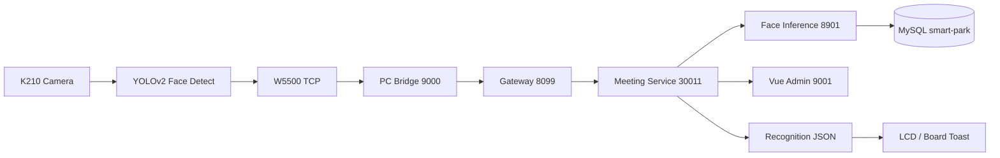

<div align="center">

<a href="#-系统快照">

</a>

<br/>

[](https://github.com/KauHY/Intelligent-Mansion/tree/front2back)
[](#-已实现闭环)
[](#-系统快照)
[](#-分支说明)

<br/>

```text
> 人脸采集 · 识别 · 签到 · 回显 —— 端到端闭环已跑通
> 首期：单会议室 · 单终端本地部署    后续：多人 · 多终端 · 园区平台
```

</div>

---

## 系统快照

<table>
<tr><th align="left">模块</th><th align="left">技术栈</th><th align="left">现状</th></tr>
<tr><td><b>现场终端</b></td><td>XiUOS / XiZi + K210 KPU + OV 摄像头</td><td>YOLOv2 连续帧检测，<code>320×240 RGB565</code> 上传</td></tr>
<tr><td><b>通信链路</b></td><td>W5500 硬件 TCP + 自定义 <code>XPH1</code> 协议</td><td>CRC32 校验、ACK 确认、识别结果 JSON 回传</td></tr>
<tr><td><b>PC 桥接</b></td><td>Python + Pillow</td><td>接收图像、方向校正、JPEG 转换、调用后端</td></tr>
<tr><td><b>人脸识别</b></td><td>YuNet + SFace</td><td>单人脸特征提取、余弦相似度、<code>0.50</code> 阈值</td></tr>
<tr><td><b>考勤业务</b></td><td>Spring Cloud + MyBatis-Plus + MySQL</td><td>人员审核、会议名单、幂等、签到状态机</td></tr>
<tr><td><b>管理前端</b></td><td>Vue + Ant Design Vue</td><td>人员、会议、详情页、上传与签到记录</td></tr>
</table>



## 快速启动

**1️⃣ 启动容器化后端**

```powershell
cd code/docker
docker compose up --build -d
docker compose ps
```

**2️⃣ 启动本机设备控制**

```powershell
cd code
.\Start-Device-Control.cmd
```

> 启动 `9010` 控制服务、监听板端串口日志，并在会议详情页按需启动 `9000` 桥接。

**3️⃣ 打开管理端** → `http://localhost:9001`

默认管理流程：

1. 登录后进入 **人脸识别签到**
2. 新增人员并上传现场人脸照片
3. 人员列表中点击 **通过** —— 只有审核通过人员才会参与识别
4. 创建会议、选择与会人员
5. 会议详情页点击 **启动本会议识别**

## 关键端口

<table>
<tr><th align="left">服务</th><th align="right">端口</th><th align="left">用途</th></tr>
<tr><td><code>face-frontend</code></td><td align="right"><code>9001</code></td><td>管理页面</td></tr>
<tr><td><code>park-gateway</code></td><td align="right"><code>8099</code></td><td>统一 API 网关</td></tr>
<tr><td><code>park-system</code></td><td align="right"><code>30010</code></td><td>登录、用户、权限</td></tr>
<tr><td><code>park-meeting</code></td><td align="right"><code>30011</code></td><td>会议与签到业务</td></tr>
<tr><td><code>face-inference</code></td><td align="right"><code>8901</code></td><td>人脸检测与特征比对</td></tr>
<tr><td><code>device_control.py</code></td><td align="right"><code>9010</code></td><td>本机设备控制</td></tr>
<tr><td><code>api_bridge.py</code></td><td align="right"><code>9000</code></td><td>板端图像桥接</td></tr>
<tr><td>MySQL</td><td align="right"><code>3307 → 3306</code></td><td>业务数据库</td></tr>
<tr><td>Redis</td><td align="right"><code>6380 → 6379</code></td><td>缓存</td></tr>
<tr><td>Nacos</td><td align="right"><code>8850 → 8848</code></td><td>注册中心</td></tr>
</table>

## 已实现闭环

- ✅ 稳定人脸触发：连续 5 帧有人脸后上传第 5 帧
- ✅ 图像上传：CRC32 校验、PC ACK、图片保存与结果回传
- ✅ 识别比对：YuNet 检测 + SFace 特征 + 余弦相似度
- ✅ 业务幂等：请求、与会人员重复签到、非成功事件去重
- ✅ 审核控制：只有启用且审核通过的人员参与识别
- ✅ 管理页面：人员管理、会议管理、详情页、记录与导出
- ✅ 板端反馈：W5500 同连接接收识别结果 JSON，并在 LCD 显示固定中文考勤结果

## 板端考勤结果显示

板端上传 RGB565 图片并收到 `XPA1` 图片保存 ACK 后，**不会立即关闭 TCP
连接**；它会继续读取 PC 桥接返回的识别结果。该能力仅适用于当前的
**W5500 有线 TCP** 链路，Wi-Fi（ESP8285 AT）链路不包含此回传消费逻辑。

```text
K210 图片上传 → PC 保存图片并回 XPA1 ACK
              → PC 调用 /verify，写入考勤结果
              → PC 回传 4B JSON 长度（网络序）+ UTF-8 JSON
              → XiUOS 校验、解析 status/message → LCD 提示
```

报文最大为 `2048` 字节，读取超时为 `3` 秒。图片 ACK 成功后，即使 JSON
超时、截断或格式不正确，板端也只降级显示“人像已完成采集”，**绝不重新上传
同一张图片**，从而避免重复签到。

| `status` | LCD 文案 | 文字颜色 |
| :---: | --- | --- |
| `1` | 签到成功 | 绿色 |
| `2` | 已签到 | 黄色 |
| `3` | 无权限 | 红色 |
| `4` | 未识别 | 白色 |
| `5` | 签到未开始 / 签到已结束 | 白色 |
| `7` | 暂不可用 | 白色 |
| 其他或结果报文失败 | 识别失败 / 人像已完成采集 | 白色 |

LCD 使用预生成的固定中文点阵字库
[`photo_toast_font.h`](XiUOS/App_Framework/Framework/knowing/kpu/k210_yolov2_detect_procedure/photo_toast_font.h)，
因此不需要在编译前手动替换该文件。PC 的 `boardText` 和姓名仍会写入板端
串口日志；为避免 K210 缺少通用中文字库时显示乱码，LCD 只显示上述固定结果文案。

### 编译 XiUOS 固件

在已配置 `make`、`riscv-none-embed-gcc` 的 XiUOS Linux/VM 构建环境中执行：

```bash
cd XiUOS/Ubiquitous/XiZi_IIoT
make BOARD=edu-riscv64
```

`make BOARD=edu-riscv64 -j2` 与上述构建内容相同，只是最多并行执行两个任务；
首次编译或排查错误时建议不加 `-j2`，日志更易阅读。

若将源码复制到另一份工作区，或修改固定 LCD 文案，可重新生成点阵头文件：

```powershell
C:\Users\10421\.cache\codex-runtimes\codex-primary-runtime\dependencies\python\python.exe pc_bridge\generate_toast_font.py
```

## 识别规则

| 分类 | 值 | 业务含义 |
| --- | :---: | --- |
| 与会人员 | `1` | 命中且属于当前会议 |
| 非与会人员 | `2` | 命中但不在当前会议名单 |
| 非记录人员 | `3` | 未命中已审核人员 |

签到状态包括成功、重复签到、无权限、未识别、时间窗外、迟到与处理失败。当前相似度阈值为 `0.50`，模型为 `SFace 2021dec`。

## 主要入口

| 路径 | 说明 |
| --- | --- |
| [`pc_bridge/api_bridge.py`](pc_bridge/api_bridge.py) | 正式识别桥接 |
| [`pc_bridge/device_control.py`](pc_bridge/device_control.py) | 设备控制服务 |
| [`face_match/service.py`](face_match/service.py) | 推理 HTTP 服务 |
| [`smart-park-backend/`](smart-park-backend/) | Spring Cloud 后端 |
| [`face-checkin/`](face-checkin/) | Vue 管理端 |
| [`docker/docker-compose.yml`](docker/docker-compose.yml) | 本地编排 |
| [`XiUOS/`](XiUOS/) | K210/XiUOS 板端代码 |
| [`XiUOS/.../photo_ethernet.h`](XiUOS/App_Framework/Framework/knowing/kpu/k210_yolov2_detect_procedure/photo_ethernet.h) | W5500 图片上传与识别结果接收 |
| [`XiUOS/.../photo_bridge.h`](XiUOS/App_Framework/Framework/knowing/kpu/k210_yolov2_detect_procedure/photo_bridge.h) | LCD 结果状态映射与渲染 |

## 当前边界

- 🔒 `/verify` 目前在网关白名单中，设备 token 适合联调，生产需要设备签名或独立凭据
- 🖼️ 人员照片仍以 base64 存库，后续应迁移到对象存储或受控文件服务
- 🧮 识别为逐人比对，后续应只提取一次现场特征并批量比对
- 🧾 CSV 导出仍需补齐公式注入防护
- 📡 前端目前轮询刷新，后续可升级 SSE/WebSocket

## 分支说明

当前 README 属于 `front2back` 分支，聚焦**端到端人脸识别签到链路**，不包含完整智慧园区所有业务能力的交付承诺。

---

<div align="center">

```text
╔══════════════════════════════════════════════╗
║   PIXEL HUD · LOCAL-FIRST · FACE CHECK-IN    ║
╚══════════════════════════════════════════════╝
```

<sub><b>K210</b> · <b>W5500</b> · <b>XiUOS</b> · <b>SFace</b> · <b>Spring Cloud</b> · <b>Vue</b></sub>

</div>
