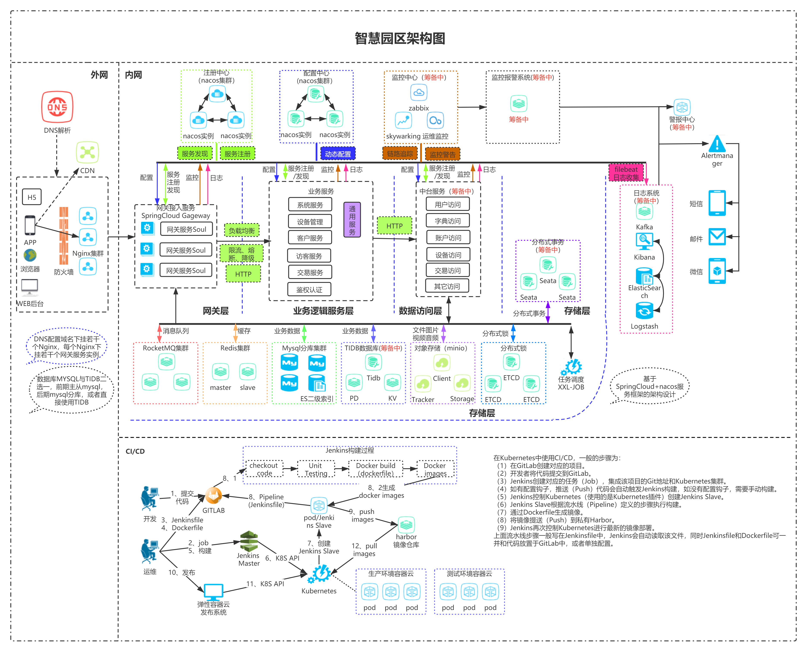

# smart-park 智慧园区运营管理平台

智慧园区 基于Java8,SpringBoot 2.3.4,SpringCloud Hoxton.SR4,Nacos,Redis,Minio等开发,
分布式微服务运营管理平台
 
## 技术栈

1. [SpringBoot 2.3.4](https://spring.io/projects/spring-boot)
2. [SpringCloud Hoxton.SR4](https://spring.io/projects/spring-cloud)
3. [nacos](https://nacos.io/zh-cn/docs/quick-start.html) 服务注册、配置中心管理
4. [Redis](https://redis.io/) 缓存
4. [Minio](http://www.minio.org.cn/) 对象存储

## 架构



## 模块

```bash
--smart-park
------|----park-api             # API包
------|----park-business        # 商机管理服务（房源招商、商机管理、客户管理）
------|----park-common          # 公共包
------|----park-contract        # 合同管理服务  
------|----park-core            # 核心包
------|----park-customer        # 客户管理服务（报事投诉、报修服务、公告管理、资讯管理、广告管理、活动管理、物品放行）
------|----park-device          # 设备管理服务
------|----park-fee             # 收费管理服务
------|----park-gateway         # 网关服务
------|----park-generate        # 代码自动生成模块
------|----park-inspection      # 巡检管理服务
------|----park-system          # 系统服务（基础业务、园区管理、入驻企业管理、系统管理）
------|----park-test            # 服务测试模块
------|----park-visitor         # 访客服务(访客管理、人行管理、车行管理)
------|----park-meeting         # 会议室服务
```